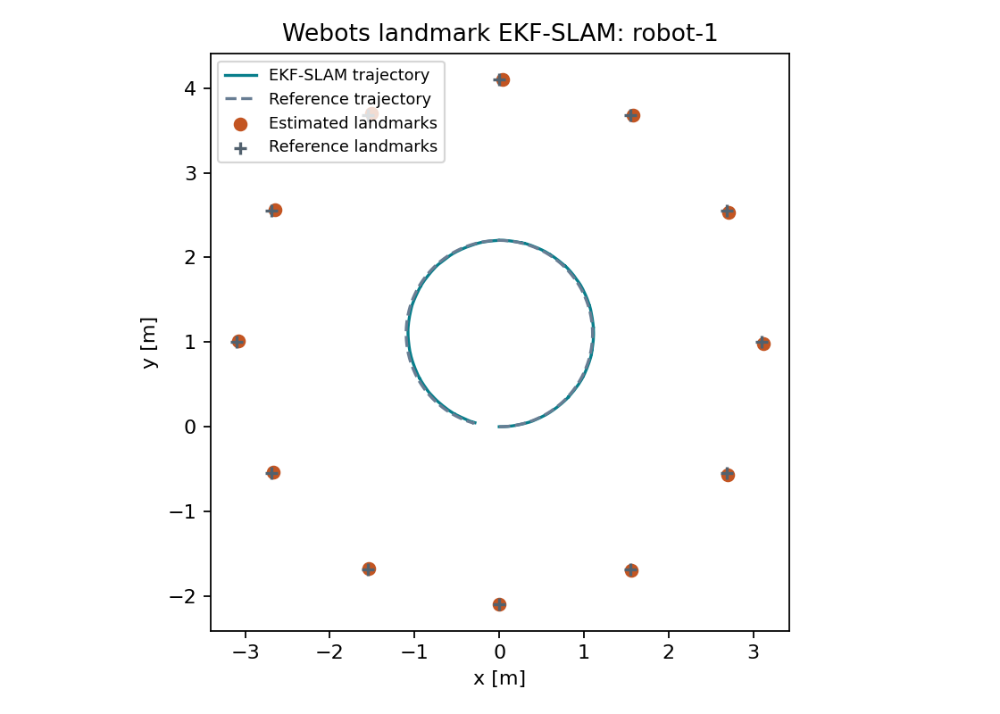
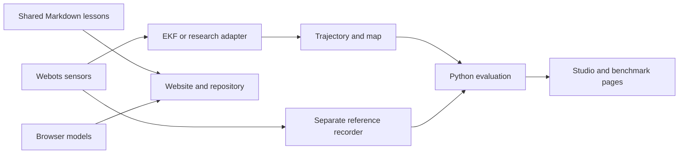

# SLAMLab

<p></p>

**Learn. Simulate. Visualize. Benchmark.**

An open laboratory for simultaneous localization and mapping. Build intuition
in the browser, run a robot in Webots, and inspect the evidence behind its map.

[](https://github.com/Kanishk-Rungta/SLAMLab/actions/workflows/validation.yml)
[](https://kanishk-rungta.github.io/SLAMLab/)
[](https://cyberbotics.com/)
[](LICENSE)

**[Explore the website](https://kanishk-rungta.github.io/SLAMLab/)** ·
**[Interactive playground](https://kanishk-rungta.github.io/SLAMLab/playground/)** ·
**[Documentation](https://kanishk-rungta.github.io/SLAMLab/documentation/)** ·
**[Contribute](CONTRIBUTING.md)**

## Explore SLAM

- **Learn:** twelve lessons connect coordinate frames, uncertainty, data
  association, EKF-SLAM, occupancy grids, visual SLAM, optimization and robot teams.
- **Experiment:** five deterministic browser models let you change sensor noise,
  match descriptors, close loops and align local maps.
- **Simulate:** Landmark Lab runs joint robot-and-landmark EKF estimation from
  wheel encoders and simulated camera range/bearing observations in Webots.
- **Visualize:** Studio replays trajectories and evolving maps, displays measured
  metrics, and opens local JSON, CSV, planar TUM and occupancy files.
- **Benchmark:** evaluate trajectories with declared frames, timestamp association,
  optional SE(2) alignment, ATE, RPE and coverage; export JSON, CSV and plots.



*A recorded Webots run, with twelve estimated landmarks and an independently
recorded reference. [Reproduction metadata](examples/results/README.md).*

## Run your first SLAM experiment

Install Python 3.10–3.12 and [Webots R2025a](https://cyberbotics.com/), then run
from the repository root:

```sh
python -m venv .venv
# Windows: .\.venv\Scripts\Activate.ps1
# Linux/macOS: source .venv/bin/activate
python -m pip install -r requirements.txt
python -B tools/slam.py list
python -B tools/slam.py run ekf-slam --robots 1 --seconds 30 --output outputs/my-slam
```

The run saves measured sensors, estimated poses, a landmark map with covariance,
separate reference data, evaluation plots and a browser replay. Choose a fresh
output directory for each run. Add `--robots 2` for two independent sessions.

```sh
python -B tools/slam.py evaluate outputs/my-slam --output outputs/my-evaluation
python -B tools/slam.py visualize outputs/my-slam --output outputs/my-replay.json
python -B tools/replay_landmark_slam.py outputs/my-slam --output outputs/my-map.json
```

Open the exported replay in [Studio](https://kanishk-rungta.github.io/SLAMLab/studio/).
The estimator uses known initial poses and marker identities, initializes unknown
landmark coordinates, and updates the joint state from relative observations.
See the [complete tutorial](docs/learning/first-slam.md) and
[sensor contract](examples/landmark-slam/README.md).

## Explore the research collection

| System | Main idea | Guide |
| --- | --- | --- |
| Landmark EKF-SLAM | Joint Gaussian pose and landmark estimation | [Run locally](algorithms/ekf-slam/README.md) |
| DOOR-SLAM | Outlier-resilient distributed pose graphs | [Stereo / ROS 1](algorithms/door-slam/README.md) |
| Kimera-Multi | Distributed metric-semantic mapping | [Stereo + IMU](algorithms/kimera-multi/README.md) |
| D²SLAM | Collaborative visual-inertial estimation | [Stereo + IMU](algorithms/d2slam/README.md) |
| Swarm-SLAM | Sparse, bandwidth-aware collaboration | [ROS 2 integration](algorithms/swarm-slam/README.md) |
| ORB-SLAM2 | Feature-based visual SLAM | [System guide](algorithms/orb-slam2/README.md) |
| RTAB-Map | Appearance-based graph mapping | [System guide](algorithms/rtabmap/README.md) |

Each research guide links its original publication, upstream code, sensor
requirements and isolated build environment. Follow native execution work in
the [research integration milestone](https://github.com/Kanishk-Rungta/SLAMLab/milestone/1).

## How the pieces connect



| Directory | Purpose |
| --- | --- |
| `algorithms/` | Estimator, system catalog and integration guides |
| `simulations/` | Webots scenarios and controllers |
| `examples/` | Configurations, tutorials and measured replay bundles |
| `benchmarks/` | Trajectory evaluation and comparison utilities |
| `tools/` | Unified CLI, launchers, replay and export tools |
| `website/` | React/TypeScript learning platform and GitHub Pages build |
| `docs/` | Curriculum, developer guides and technical references |
| `experiments/ab3/` | Preserved AB3 environment and research adapters |

## Develop the platform

Use Node.js 24 LTS for the website:

```sh
cd website
npm ci
npm run dev
```

See [website development](website/README.md) for build, browser tests and hosting.
Run Python and integration contract checks with
`python -B tools/validation/run_checks.py` from the root.

Contributions can add a calibrated sensor adapter, a reproducible run, a clear
lesson, or an accessible visualization. Read [CONTRIBUTING.md](CONTRIBUTING.md),
the [development guide](docs/development.md), and [open issues](https://github.com/Kanishk-Rungta/SLAMLab/issues).

## Project background and citation

SLAMLab grew from **Edge-Based Multi-Robot System for Collaborative SLAM and
Autonomous Task Coordination**, Team 98's research into shared indoor mapping,
local robot processing and coordinated exploration. It consolidates reusable
educational, simulation, SLAM integration and evaluation resources. The
[original project](https://github.com/Kanishk-Rungta/Final-Year-Project) preserves
that research history. SLAMLab focuses on software, simulation and reproducible
multi-robot mapping experiments. See the [project overview](docs/project/README.md)
for the problem statement, objectives, team and evidence-based progress.

Project-authored code is [MIT licensed](LICENSE). Imported components retain
their original licenses; see [third-party notices](THIRD_PARTY_NOTICES.md).
Use [CITATION.cff](CITATION.cff) to cite the platform and cite each algorithm's
[original research](docs/references/README.md) when using its method.
