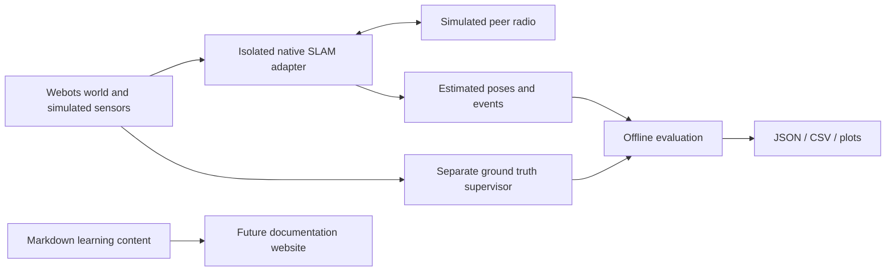

# SLAMLab

**Learn. Simulate. Visualize. Benchmark.**

An open-source interactive platform to learn, simulate, visualize, and benchmark
SLAM algorithms using Webots and reproducible experiments.

SLAMLab brings reviewed simulation assets, research-system adapters, evaluation
utilities and beginner-friendly explanations into one technical repository.
The immediate goal is reproducible software and simulation: understand the
inputs, preserve provenance, inspect actual output and describe limitations.
Physical robot deployment is outside this repository's scope.

## Available now

- A preserved AB3 first-floor Webots R2025a environment, robot PROTOs, stereo/IMU/
  encoder/radio model, fixed start poses and evaluation-only occupancy truth.
- A bounded one- or two-robot **wheel-odometry teaching example**, executed locally
  with separate estimated and ground-truth recordings. This example is not SLAM.
- Team-authored adapters and pinned external dependency metadata for four native
  research systems; source preparation is distinct from native validation.
- Strict planar trajectory conversion, timestamp association, optional SE(2)
  alignment, ATE/RPE, comparison tables and JSON/CSV/PNG exports.
- Audited source provenance, practical tutorials and lightweight validation.

## Algorithm status

| System | SLAMLab integration | Native build / SLAM run verified here |
| --- | --- | --- |
| [DOOR-SLAM](algorithms/door-slam/README.md) | Stereo/radio adapter; source and calibration preparation verified | No |
| [Kimera-Multi](algorithms/kimera-multi/README.md) | Stereo/IMU/radio adapter; external workspace required | No |
| [D?SLAM](algorithms/d2slam/README.md) | Stereo/IMU/LCM adapter; sparse source restoration and preparation verified | No |
| [Swarm-SLAM](algorithms/swarm-slam/README.md) | Stereo/backend/radio adapter; external workspace/model required | No |
| [ORB-SLAM2](algorithms/orb-slam2/README.md) | Reference guide; standalone implementation not found in source checkout | Not integrated |
| [RTAB-Map](algorithms/rtabmap/README.md) | Existing dependency/bridge; standalone reference guide | Not integrated |

Adapters are implemented but native execution remains unverified in SLAMLab.
No algorithm ranking or full mapping/collaboration benchmark is published.
The [inventory](docs/implementation-inventory.md) records the original evidence,
including additional systems deliberately left outside this first import batch.

## Architecture



Ground truth is reserved for evaluation. Every native stack retains its own
ROS/dependency environment. The preserved AB3 workspace remains a coherent
compatibility unit; navigation directories link to it without duplicating code.

## Quick start

Use Python 3.10?3.12. From the repository root:

```sh
python -m venv .venv
# Activate .venv using your shell; see installation below.
python -m pip install -r requirements.txt
python -B -m unittest discover -s tests -v
python -B tools/slam.py doctor d2slam
```

See [installation](docs/getting-started/installation.md) for Windows and Unix
activation commands. Direct host dependencies are pinned; this is not a complete
transitive environment lock. Record installed versions with each real experiment.

Evaluate the included **synthetic mathematical fixture**, with known 0.1 m offset:

```sh
python -B benchmarks/evaluation/trajectory.py evaluate --estimate examples/trajectory-evaluation/estimate.csv --reference examples/trajectory-evaluation/reference.csv --metadata examples/trajectory-evaluation/metadata.json --output outputs/first-evaluation
```

Inspect the generated `metrics.json`, `summary.csv`, `associated.csv` and
`trajectory.png`. Choose a new output directory when repeating the command.
The fixture is not a recorded robot trajectory or measured SLAM performance.

## Webots simulations

Install **Webots R2025a** separately, then run:

```sh
python -B tools/run_webots_demo.py --prepare-only --robots 1
python -B tools/run_webots_demo.py --robots 1 --seconds 10
```

The short odometry example derives its world without editing the standard,
records unique output under `outputs/`, and terminates automatically. Use
`--robots 2` for two independent simulated robots. For paths, sensors, controller
configuration, outputs and known limitations, see the
[simulation index](simulations/webots/README.md) and [AB3 contract](docs/simulations/ab3.md).

## Native installation overview

```sh
python -B tools/slam.py doctor door-slam
python -B tools/setup/fetch_original_sources.py door-slam
python -B tools/slam.py prepare door-slam --robots 2
# On a host with Docker and Linux containers:
python -B tools/slam.py build door-slam --robots 2
python -B tools/slam.py run door-slam --robots 2 --seconds 120 --gui
```

These last two commands are the documented acceptance path, not a claim of a
verified run. Check the [algorithm guide](algorithms/door-slam/README.md) before
fetching dependencies. Windows/macOS native execution uses Linux containers;
Melodic, Noetic and Humble stacks stay isolated. CPU, RAM and disk requirements
for full native builds have not been measured here. Models and native snapshots
remain ignored local dependencies. Preparation does not install global packages.

## Benchmarking and visualization

The [focused evaluator](docs/benchmarking/metrics.md) defines units, frames,
association, alignment and missing-data behavior. It exports machine-readable
summaries and a standalone trajectory plot. The
[original AB3 recorder/evaluator](experiments/ab3/Standard%20Environment/benchmark/README.md)
remains available for its native event/map formats, with explicit metric limits.

[Examples](examples/trajectory-evaluation/README.md) demonstrate analytic checks;
[visualization guidance](visualizations/README.md) explains trajectories, occupancy
maps and point clouds. Missing maps, resource samples or peer-message evidence
are not converted into invented measurements.

## Learn and contribute

Start with [SLAM fundamentals](docs/fundamentals/README.md), the
[first experiment](docs/tutorials/first-experiment.md),
[reading outputs](docs/tutorials/reading-results.md) and
[troubleshooting](docs/troubleshooting/README.md).
The [documentation index](docs/README.md) provides the complete navigation.

Read [CONTRIBUTING](CONTRIBUTING.md), [community standards](CODE_OF_CONDUCT.md)
and [security reporting](SECURITY.md). Contributions should preserve upstream
attribution and separate source availability, preparation, compilation,
initialization, collaboration and measured performance.

## Repository structure

```text
algorithms/             Per-system guides and status
simulations/webots/     Scenario index and teaching controllers
experiments/ab3/        Preserved shared simulation and native adapter workspace
benchmarks/evaluation/  Focused trajectory evaluation and comparison
examples/               Labeled analytic fixtures
visualizations/         Output interpretation and plot guidance
tools/                  Launch, source restoration and validation
tests/                  Standalone known-answer and integrity tests
docs/                   Learning, audit and validation records
website/                Future content-consumption plan
.github/                Community templates and lightweight CI
```

## Status and roadmap

Completed: reviewed repository foundation, imported simulation/adapters,
source preparation for DOOR/D?, bounded Webots odometry execution, standalone
evaluation and learning content. Consult [actual checks](docs/validation-report.md).

Next: build each native stack on a Docker host, validate initialized tracking and
backend corrections, test two-robot radio routes/outage recovery, preserve real
experiment provenance, then expand controlled benchmarks. A future interactive
website should consume these explicit status records and documented examples.
See the [website next phase](website/README.md). No frontend is implemented here.

## Team, attribution and license

Maintained by Kanishk Rungta with contributions welcomed through GitHub. Team
component redistribution was explicitly confirmed by the owner. No university
affiliation, research publication or original authorship of upstream algorithms
is implied. Cite SLAMLab using [CITATION.cff](CITATION.cff) and the systems you use
from the [research references](docs/references/README.md).

Original SLAMLab and authorized team-owned components use [MIT](LICENSE).
External systems/models retain their own terms, and the Kimera native adapter's
existing BSD package declaration is preserved. See [third-party notices](THIRD_PARTY_NOTICES.md),
[source provenance](docs/source-provenance.md) and the per-file
[import manifest](docs/import-manifest.json). No source-project Git history,
physical-board code, credentials or private recordings are included.
